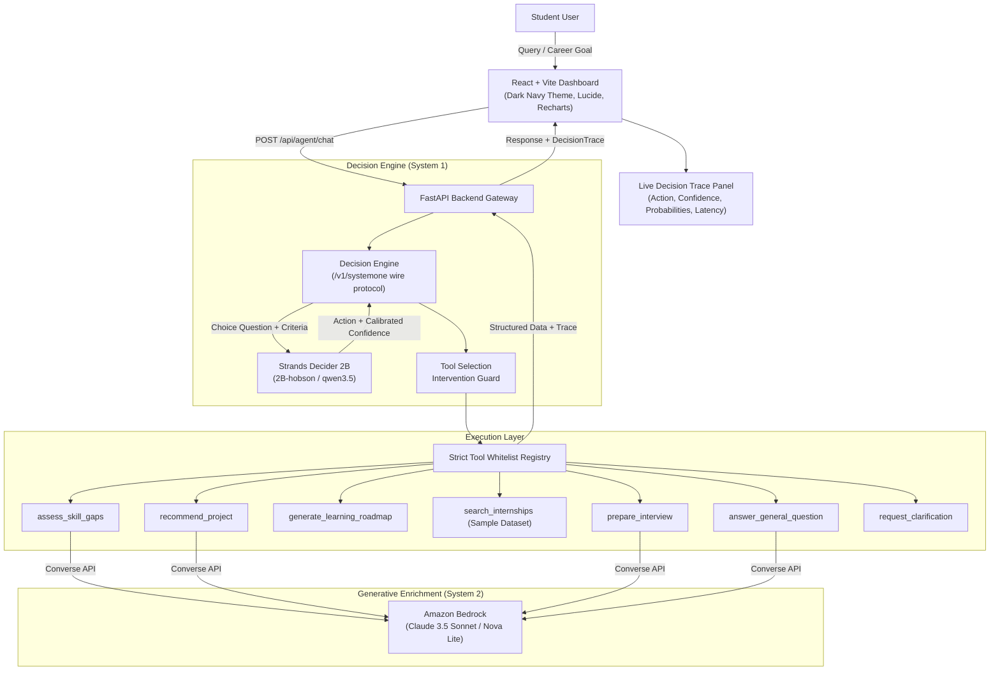

# SkillPilot AI 🚀
> **Your Skills. Your Goals. Your Next Move.**

[](https://aws.amazon.com/)
[](https://strandsagents.com/blog/introducing-strands-decider/)
[](https://aws.amazon.com/bedrock/)
[](#-the-tool-selection-decision-pattern)
[](https://fastapi.tiangolo.com/)
[](https://vitejs.dev/)
[-brightgreen)](#-automated-tests)

---

## 🌟 Executive Summary

**SkillPilot AI** is an intelligent, autonomous career copilot designed for engineering, computer science, and AI/ML students preparing for internships and placements.

Traditional conversational chatbots merely output walls of unverified text. **SkillPilot AI goes further by making genuine, observable architectural decisions**:
1. Uses **Strands Decider 2B** as a fast "System One" decision model to evaluate student requests in sub-50ms and select the appropriate executable tool.
2. Uses the **Strands Agents SDK** (`strands-agents`) to orchestrate execution with strict intervention guardrails.
3. Uses **Amazon Bedrock** (Claude 3.5 Sonnet / Amazon Nova) for rich, personalized career guidance and resume advice.
4. Provides a publicly reusable decision pattern recipe in `decision_patterns/tool_selection/`.

---

## 🏷️ Required Hackathon Tags
- `#strands-decider-2b`
- `#tool-selection`

---

## 💡 The Problem & The Solution

| The Challenge | Traditional Chatbots | SkillPilot AI |
|---|---|---|
| **Action vs Text** | Generates text answers without executing actions | Selects from 7 discrete tools and executes real workflows |
| **Routing Latency** | 70B+ LLM generates tokens for routing (800ms–2,500ms) | **Strands Decider 2B** selects tools in a single forward pass (<50ms) |
| **Confidence** | Arbitrary or fabricated confidence numbers | **Mathematically calibrated confidence**: $(N \cdot p_{\max} - 1)/(N - 1)$ |
| **Execution Safety** | Vulnerable to hallucinated tool signatures | Strict whitelist registry with intervention guards |
| **Cost** | Expensive token burns for simple intent triage | Lightweight 2B decision model + Bedrock called only when needed |

---

## 🏛️ System Architecture

SkillPilot AI decouples high-speed intent routing from generative reasoning:



---

## 🎯 The `#tool-selection` Decision Pattern

### Typed Decision Question
```text
"Given the student's current request, relevant profile, available tools, and current application state, which action should the agent take next?"
```

### The 7 Registered Action Options
| Action Option | Description & Role |
|---|---|
| `assess_skill_gaps` | Compares student skills against target role curriculum; calculates curriculum match index. |
| `recommend_project` | Recommends hands-on portfolio capstone blueprints with milestones and effort estimates. |
| `generate_learning_roadmap` | Generates a 6-week structured study curriculum with weekly objectives and checkpoints. |
| `search_internships` | Filters sample internship opportunities by skills, role, and location with matching reasons. |
| `prepare_interview` | Compiles technical topics, DSA patterns, project discussion questions, and a 7-day study plan. |
| `answer_general_question` | Provides general career advice or technical guidance using Amazon Bedrock. |
| `request_clarification` | Asks the student clarifying questions when the request is ambiguous or context is missing. |

### Calibrated Confidence Formula
$$\text{Confidence} = \frac{N \times p_{\max} - 1}{N - 1}$$
- Independent of option count $N$.
- If confidence $< 0.65$ or request is ambiguous (e.g. *"hey"*), the intervention guard intercepts execution and routes to `request_clarification`.

---

## 🛠️ Technology Stack

- **Frontend:** React 18, Vite 6, Tailwind CSS, Lucide React icons, Recharts.
- **Backend:** Python 3.10+, FastAPI, Pydantic v2, Uvicorn.
- **AI Decision Model:** Strands Decider 2B (`strands-decider` wire protocol).
- **Agent Orchestrator:** Strands Agents SDK (`strands-agents` v1.62.0).
- **Generative AI:** Amazon Bedrock (Claude 3.5 Sonnet / Amazon Nova via Boto3 Converse API).
- **Storage:** JSON / SQLite abstract storage interface (MongoDB ready).
- **Testing:** Pytest (21 automated unit and integration tests).

---

## ⚡ Quickstart Guide

### 1. Prerequisites Check
Ensure you have Node.js 18+ and Python 3.10+ installed:
```powershell
node -v
python --version
```

### 2. Backend Setup

#### Create & Activate Virtual Environment
```powershell
# Windows PowerShell:
python -m venv backend\.venv
backend\.venv\Scripts\Activate.ps1

# Linux / macOS:
python3 -m venv backend/.venv
source backend/.venv/bin/activate
```

#### Install Backend Dependencies
```powershell
pip install -r backend/requirements.txt
```

#### Configure Environment
Copy the backend environment template:
```powershell
cp backend/.env.example backend/.env
```
*(Optional: Add your `AWS_ACCESS_KEY_ID` and `AWS_SECRET_ACCESS_KEY` if testing live Amazon Bedrock calls. If unconfigured, the application runs in honest Demo Fallback mode).*

#### Run Backend Automated Tests
```powershell
python -m pytest -v
```
*(All 21 unit and integration tests run locally without requiring paid API tokens).*

#### Start Backend Server
```powershell
python scripts/run_backend.py
```
Backend will start on `http://localhost:8000`. API docs available at `http://localhost:8000/docs`.

---

### 3. Frontend Setup

In a new terminal:
```powershell
cd frontend
npm install
npm run build
npm run dev
```
Open `http://localhost:5173` in your browser.

---

## 🧪 Testing & Decision Lab

SkillPilot AI includes a dedicated **Decision Lab** (`/decision-lab`) allowing judges and developers to submit arbitrary requests or test pre-built cases:
1. **Skill Gap Assessment**: *"Compare my skills against Full-Stack AI Engineer requirements"*
2. **Project Blueprint**: *"Suggest a capstone project using Strands Decider and Bedrock"*
3. **Learning Roadmap**: *"Generate a 6-week study curriculum for my career goal"*
4. **Internship Search**: *"Find sample remote internships matching Python and React"*
5. **Interview Prep**: *"Prepare technical interview questions, coding patterns, and a schedule"*
6. **General Guidance**: *"What is the industry difference between an AI Engineer and a Software Engineer?"*
7. **Ambiguous Guardrail**: *"hey"* $\rightarrow$ Triggers `request_clarification`

---

## 📦 Standalone Reusable Decision Recipe

Developers can reuse the `#tool-selection` pattern in their own agents without any SkillPilot AI dependencies.

Files located in:
```
decision_patterns/tool_selection/
├── README.md               # Complete architecture & reuse documentation
├── recipe.py               # Standalone AdaptiveToolSelector class
├── example.py              # Minimal runnable example (customer triage)
└── tests/test_recipe.py    # Unit tests for the recipe
```

Run the standalone example:
```powershell
python decision_patterns/tool_selection/example.py
```

---

## 🔒 Security & Reliability

- **No Hardcoded Credentials**: All AWS credentials load from standard AWS credential providers, IAM instance roles, or `.env`.
- **Zero Client-Side Secret Leakage**: The React frontend never receives or handles AWS credentials.
- **Strict Execution Whitelist**: Only actions defined in `TOOL_REGISTRY` can execute; arbitrary string execution is strictly rejected.
- **Transparent Fallback**: When Amazon Bedrock or live Decider 2B are unconfigured, responses are clearly marked with `is_fallback: true` and `model_provider: demo-fallback`. Real model success is never fabricated.
- **Sample Data Notice**: All internship listings are curated sample mock data and clearly labeled as non-live vacancies.

---

## 📂 Repository Structure

```
skillpilot-ai/
├── backend/
│   ├── app/
│   │   ├── main.py              # FastAPI endpoints
│   │   ├── config.py            # Pydantic v2 application settings
│   │   ├── agent.py             # SkillPilot Agent & Intervention Guard
│   │   ├── decision_engine.py   # Strands Decider 2B System One adapter
│   │   ├── bedrock_service.py   # Amazon Bedrock Converse API service
│   │   ├── schemas.py           # Pydantic request & response schemas
│   │   ├── tool_registry.py     # Immutable action whitelist & dispatcher
│   │   ├── tools/               # 7 testable Python tools
│   │   ├── storage/             # Abstract JSON/SQLite storage layer
│   │   └── data/                # Student profile, role matrices, sample data
│   ├── tests/                   # 21 automated backend tests
│   ├── requirements.txt         # Python dependencies
│   └── .env.example             # Environment template
├── frontend/
│   ├── src/
│   │   ├── components/          # Navbar, DecisionTracePanel
│   │   ├── pages/               # Landing, Dashboard, Workspace, DecisionLab...
│   │   ├── services/            # API client
│   │   ├── App.jsx              # Main React SPA
│   │   └── main.jsx             # Entrypoint
│   ├── package.json             # NPM dependencies
│   └── vite.config.js           # Vite build config
├── decision_patterns/
│   └── tool_selection/          # Reusable decision recipe & example
├── docs/
│   ├── architecture.md          # Architectural blueprints & diagrams
│   ├── aws-setup.md             # AWS & Bedrock onboarding guide
│   ├── decision-pattern.md      # Pattern deep-dive
│   ├── deployment.md            # AWS App Runner / S3 deployment guide
│   ├── builder-center-article.md# AWS Builder Center article draft
│   ├── demo-video-script.md     # < 3 min demo video script
│   └── submission-checklist.md  # Hackathon submission checklist
├── scripts/
│   └── run_backend.py           # Server launch helper
├── pytest.ini                   # Pytest configuration
├── LICENSE                      # MIT License
└── README.md                    # Project documentation
```

---

## 🚀 Future Roadmap
1. **Dynamic Fine-Tuning**: Fine-tuning Strands Decider pointer heads on historical placement datasets.
2. **MongoDB Atlas Integration**: Transitioning the abstract storage interface to a managed MongoDB cluster.
3. **Multi-Agent Collaboration**: Orchestrating specialized peer agents (e.g. Resume Screener, Mock Coding Interviewer).

---

## 📄 License
This project is licensed under the [MIT License](LICENSE).
