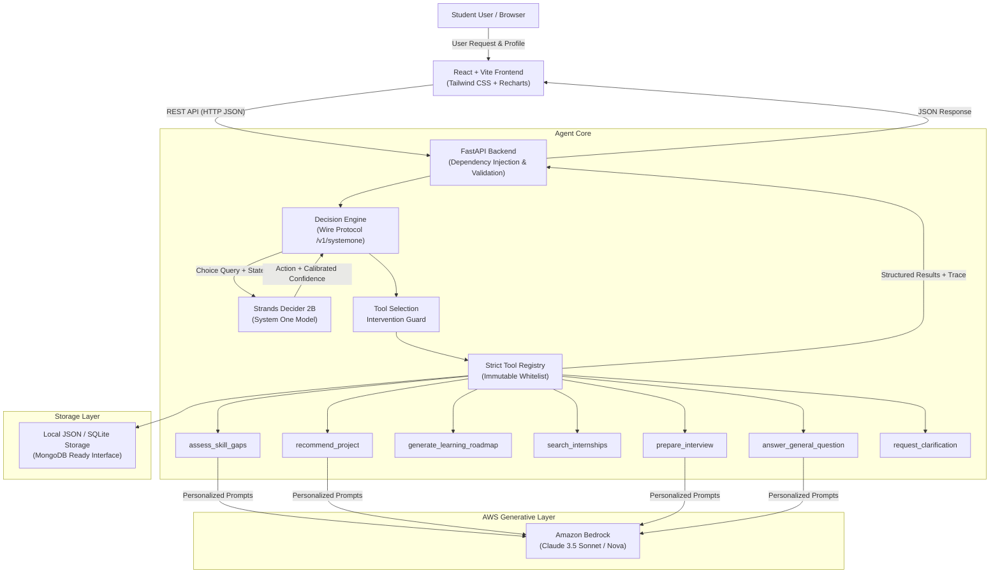

# SkillPilot AI - System Architecture

**Tagline:** Your Skills. Your Goals. Your Next Move.  
**Hackathon Category:** AI Agent, Career Intelligence, Student Skill Development  
**Core Tags:** `#strands-decider-2b` `#tool-selection`  

---

## 1. Architectural Overview

SkillPilot AI decouples fast "System One" decision-making from rich generative text synthesis:

1. **Routing Layer (Strands Decider 2B):** Evaluates incoming requests and current student state against typed criteria in a single forward pass (<50ms).
2. **Orchestration Layer (Strands Agents SDK):** Implements an intervention guard ensuring only permitted, registered tools are executed.
3. **Synthesis Layer (Amazon Bedrock):** Generates personalized career advice, resume tips, and interview coaching using Claude 3.5 Sonnet or Nova.
4. **Presentation Layer (React + Vite + Tailwind):** Renders interactive dashboard, chat workspace, and a live Decision Trace panel showing calibrated probabilities.

---

## 2. Decision Flow Lifecycle

1. **State Ingestion:** FastAPI receives `AgentChatRequest` containing the user prompt and session state.
2. **Profile Retrieval:** The student's academic background, skills, and target career goal are loaded from storage.
3. **Decider Query:** The request state is packaged into a compliant `/v1/systemone` payload containing the decision question and 7 discrete option criteria.
4. **Confidence Verification:** Strands Decider evaluates the input. Confidence is derived via:
   $$\text{Confidence} = \frac{N \times p_{\max} - 1}{N - 1}$$
5. **Execution Guard:** If confidence meets threshold ($\ge 0.65$), the action is dispatched. If ambiguous or low-confidence, the guard routes to `request_clarification`.
6. **Tool Execution:** The registered Python tool executes deterministically (e.g., skill matrix evaluation or internship filtering).
7. **Generative Enrichment:** Amazon Bedrock is invoked via the Converse API to synthesize personalized coaching advice.
8. **Telemetry & Decision Trace:** Complete trace metrics (selected action, confidence, latency, source, probabilities) are returned and displayed in the UI.

---

## 3. Technology Matrix

| Layer | Component | Version / Spec |
|---|---|---|
| Frontend | React.js, Vite, Tailwind CSS | React 18, Vite 6, Tailwind 3.4 |
| UI Components | Lucide React, Recharts | Lucide 0.475, Recharts 2.15 |
| Backend API | FastAPI, Pydantic, Uvicorn | FastAPI 0.115, Pydantic v2 |
| Decision Engine | Strands Decider 2B | Wire Protocol `/v1/systemone` |
| Agent Orchestration | Strands Agents SDK | `strands-agents` v1.62.0 |
| Generative AI | Amazon Bedrock Runtime | Claude 3.5 Sonnet / Converse API |
| Cloud SDK | AWS Boto3 / Botocore | Boto3 v1.34+ |
| Persistence | Abstract JSON / SQLite Interface | Extensible to MongoDB Atlas / DynamoDB |
